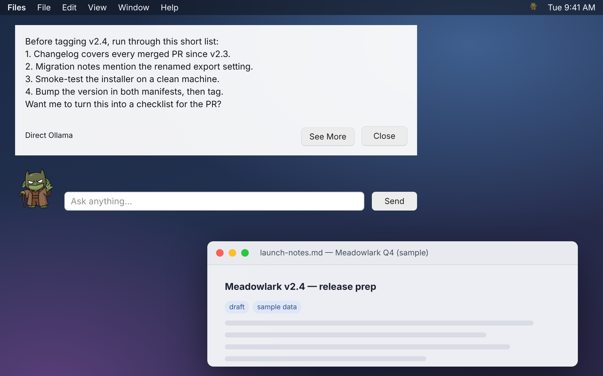
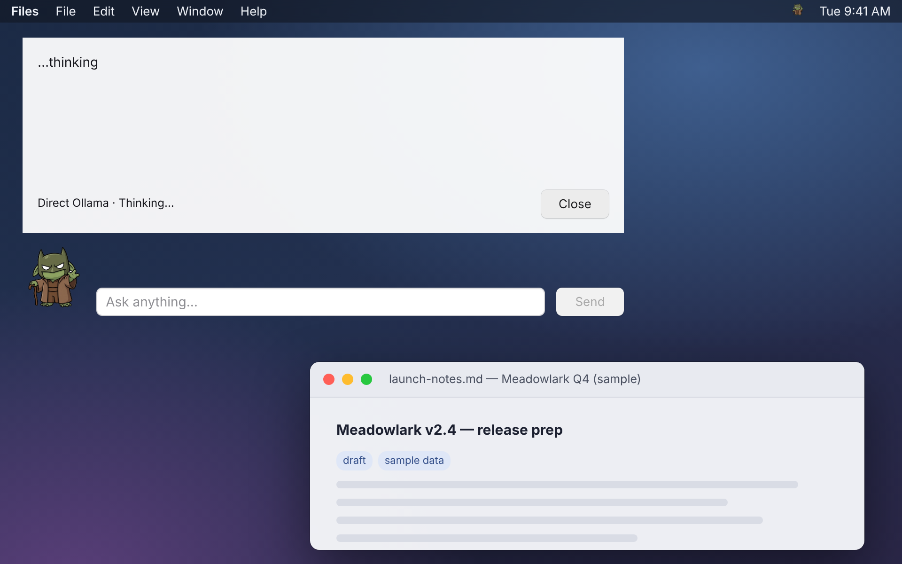
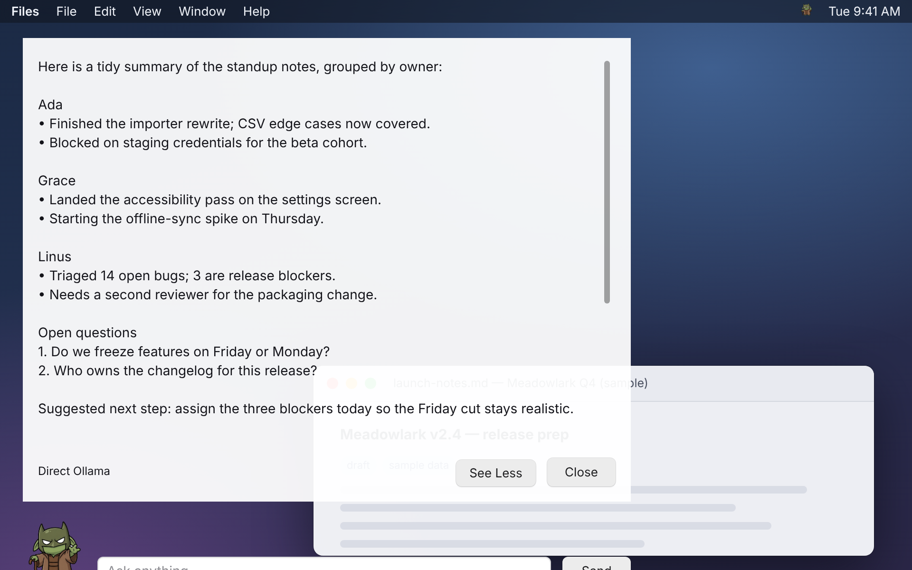
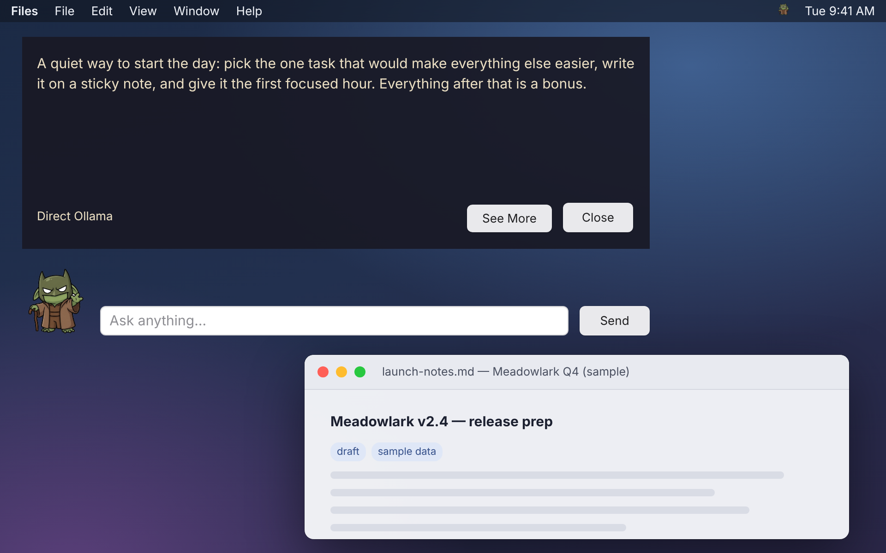
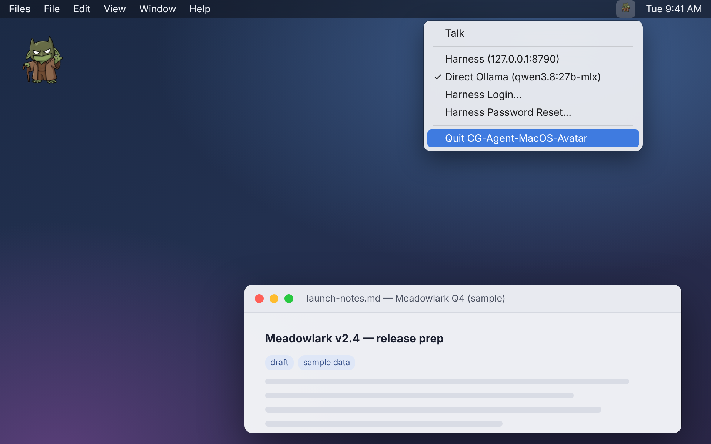
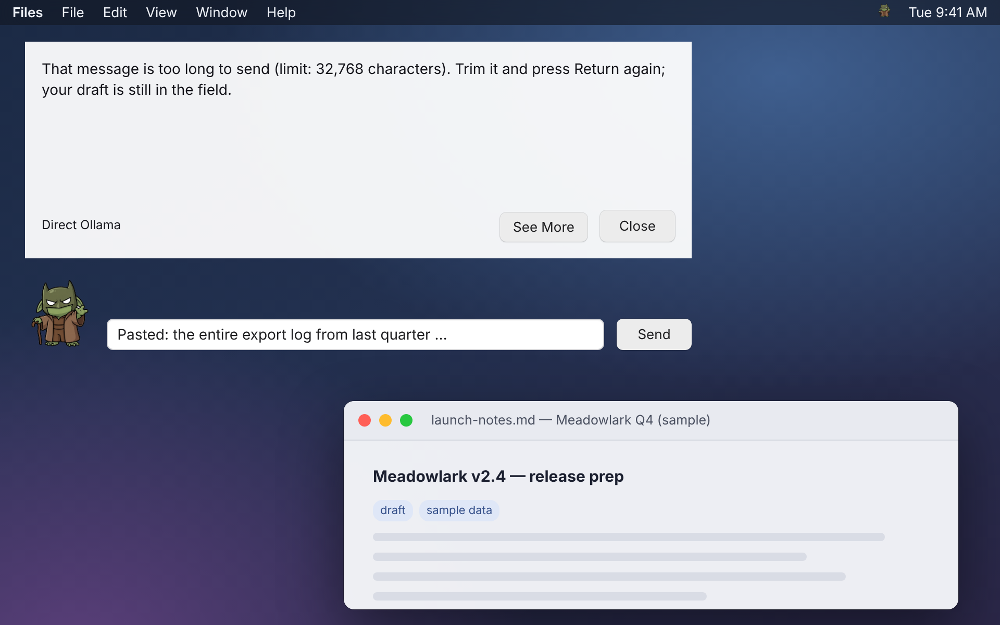
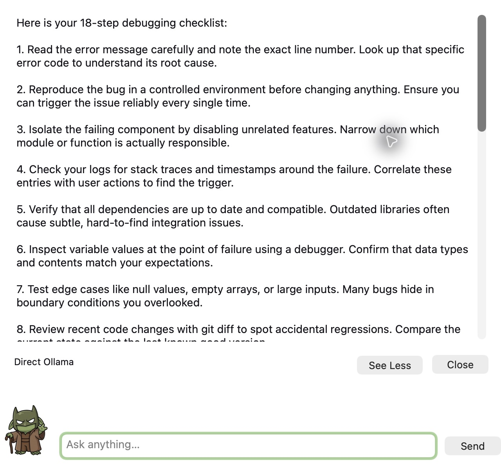

# CG-Agent-MacOS-Avatar

**A little creature. A conversation within reach.**

Avatar puts your local AI on your desktop as a walking companion for **Apple
Silicon Macs running macOS 13 or newer**, written in Rust. Click the creature,
ask a question, and read the answer right above it. Its moods show when it is
resting, thinking, talking, or needs attention.

- **Stay in the flow.** Open a chat panel that holds still, send with Return or
  **Send**, and close it without losing your draft or the reply.
- **Room to read.** Padded replies, larger text, and a separate toolbar keep the
  conversation clear. **See More** opens a scrollable plain-text pane.
- **Pick the engine.** Start with a local Ollama (the default) or connect to
  [CG-Agent-Harness](https://github.com/cgfixit/CG-Agent-Harness).
- **Nothing leaves your Mac by accident.** Avatar talks only to loopback
  addresses, and Direct Ollama reaches the web only when you ask it to in so
  many words.



*Illustration with synthetic sample data, rendered from the app's theme tokens (not a native capture). See [screenshots](screenshots/README.md); native captures are in [docs/screenshots](docs/screenshots/README.md).*

## Install

### Option 1: download a release

1. Download `CG-Agent-MacOS-Avatar.zip` and its `.sha256` file from
   [Releases](https://github.com/cgfixit/CG-Agent-Avatar/releases).
2. Check the download, then unzip it:

   ```sh
   shasum -a 256 -c CG-Agent-MacOS-Avatar.zip.sha256
   unzip CG-Agent-MacOS-Avatar.zip
   ```

3. Move `CG-Agent-MacOS-Avatar.app` to Applications and open it. The app is
   ad-hoc signed and **not notarized**, so the first launch may be blocked.
   Open **System Settings → Privacy & Security**, scroll to the message about
   the app, and choose **Open Anyway**. You only need to do this once.

Avatar lives in the menu bar (no Dock icon). Look for the creature icon at the
top of the screen.

Every merge to `main` also leaves a **bundle** artifact under Actions (kept for
14 days), a scheduled run publishes a prerelease at noon New York time when
commits have changed, and a manual run from `main` (Actions → **bundle** →
*Run workflow*) publishes a full release, optionally marked Latest with your own
notes. Runs from other branches publish prereleases. Downloaded builds are
ad-hoc signed, not notarized, exactly like local ones.

### Option 2: build from source

You need Apple's Command Line Tools and Rust installed through rustup; the
repository selects Rust 1.88 for you.

```sh
xcode-select --install          # once, if you don't have it
./scripts/package-app.sh
open dist/CG-Agent-MacOS-Avatar.app
```

[Build and verification](docs/BUILD.md) covers prerequisites, toolchain setup,
local checks, and how to validate the package.

## Choose a backend

Avatar never starts a model server for you. Pick one of these and have it
running before you expect a reply. Typing works either way; a backend is only
needed for the answer.

| Backend | What you need | What Avatar does |
|---|---|---|
| **Direct Ollama** (default) | Ollama listening on `http://127.0.0.1:11434` with the exact model tag `qwen3.8:27b-mlx` pulled. Ollama has its own [macOS requirements](https://docs.ollama.com/macos), including macOS 14 or newer. | Sends the bundled [Soul prompt](resources/direct-ollama-system.md) plus your current message and asks for a direct answer without a hidden reasoning pass. It never installs models or sends previous turns. |
| **Harness** | The CG-Agent-Harness desktop app installed, or a headless `cgagentharness serve`. | Choose **Harness (127.0.0.1:8790)** from the menu. Avatar opens the installed desktop app, finds its listener, and reuses or creates a session titled `CG-Agent`. Harness manages its own model and conversation. |

A responding Ollama does not guarantee the fixed model tag is available; the
bubble says `pull qwen3.8:27b-mlx` when it is missing. The chat panel names the
selected backend, and Harness setup steps appear in the reply area when needed.
[Controls](docs/CONTROLS.md) lists every menu item and bubble message.

### Web lookups (Direct Ollama)

Avatar stays local unless you ask for the web in plain words:

- "search the web for best pizza in Atlanta", "please look up rust 1.90 release date", "google: rust", or "please google …"
- "read https://…", or "summarize https://…"

Avatar then requests one search (up to five results) or one page through the
local Ollama service, passes the response to the model as untrusted reference
text, and marks the answer with what was sent, such as
`[via web: searched "rust 1.90"]`. A bare verb is never enough: "Google Chrome
keeps crashing", "look up rust 1.90 release date", and "search for meaning" are
answered on your Mac, and the reply ends with `Answered on this Mac only. To
look it up online, say: search the web for …`. Nothing is sent until you do.
See [all supported phrases](docs/CONTROLS.md#web-lookups-direct-ollama).

Lookups need an Ollama that offers its experimental web routes, signed in with
`ollama signin`, with cloud features enabled. **The query or link leaves your
Mac through Ollama's cloud service.** Avatar itself connects only to loopback
and holds no API key. Private hosts, link-local addresses, `.local` names,
single-word hosts, and links with embedded credentials are refused.

## Screenshots

Illustrations with synthetic sample data, rendered from the app's theme tokens.

| | |
|---|---|
|  **Thinking.** The panel names the backend, Send waits, and the draft field stays free. |  **See More.** A long reply opens in a scrollable plain-text pane. |
|  **Fable Protocol theme** (`CG_AGENT_THEME=fable-protocol`). |  **Menu-bar menu.** Pick Direct Ollama or Harness; Harness login lives here. |
|  **Oversized draft.** A clear notice instead of a silent no-op; the draft stays put. | |

## Talk, read, carry on

Click the creature or choose **Talk** from its menu-bar menu. The panel stays in
place while you type and read. **Return** or **Send** submits your message, and
`…thinking` stays up until the reply arrives (replies are not streamed). You can
write a draft even when the backend is unavailable.



**See More** expands the reply within the screen; **See Less** restores the
compact bubble. Longer replies scroll. **Close** hides the conversation and lets
the creature roam again; click it to return to your draft and reply. Empty
overlay space passes clicks through to the application underneath.

Both backends share the renderer: previews show up to 400 characters and expanded
replies up to 8,000, with an ellipsis at the limit. Input accepts 32,768 characters
after trimming, which is a character limit, not a model-context guarantee.

Classic pairs dark text with a translucent white surface. The optional Fable
Protocol theme uses warm text on a dark surface and a calmer gait.
[Controls and themes](docs/CONTROLS.md) covers theme selection, menu actions, and
troubleshooting messages.

## Harness TLS and login

Avatar reads the selected Harness home's port and leaf certificate. The default
home is `~/.CGagentHarness`; `CGAGENTHARNESS_HOME` may select another absolute
path without `..` components. Avatar never reads `.env`.

For TLS homes, Avatar pins `tls/server.pem` without changing Keychain trust or
disabling certificate validation. Keep both apps pointed at the same home.
Legacy HTTP homes remain supported; a home with a certificate never falls back
to plain HTTP.

For an account-gated home:

1. Select **Harness (127.0.0.1:8790)**. Avatar opens Harness and waits for a
   confirmed loopback status response before showing the next step.
2. When prompted, choose **Harness Login…**, enter your Harness account, and
   wait for the result. Login alone does not select the backend.
3. If a bootstrap password change is required, choose **Harness Password
   Reset…**. Enter the current password and a new one of at least 12 characters.
   **OK** submits; **Cancel** leaves it unchanged. Avatar checks status again
   before enabling chat.

Configure missing models, providers, or keys in Harness, then wait for the next
status check. Drafts stay in the field while setup is incomplete. Password Reset
changes only the authenticated account; it is not forgotten-password recovery.
Credentials and cookies stay in memory, so a restart needs another login.

### Harness port and launch

Headless serving normally uses **8790**, or the port in `harness.json`; the desktop
sidecar uses an ephemeral port. Avatar probes the configured port, discovers
candidates with argv-only `lsof`, and validates `GET /api/status`. It never scans
port ranges or uses the desktop focus socket. Do not run desktop and headless
Harness against the same home.

Launch Services opens bundle ID `com.cgfixit.agent-harness`, activating an existing
instance. An unregistered app produces installation or headless-serving guidance.
Avatar never spawns Harness, passes launch arguments, or hardcodes an install path.

## Clear boundaries

Avatar stays a client: it never runs agent jobs or administers Harness accounts.

- Avatar connects only to literal loopback addresses (`127.0.0.1` and `::1`),
  rejecting `localhost` names and HTTP redirects.
- Direct Ollama receives no tool definitions, API keys, or agent jobs. Avatar
  never fetches web pages itself.
- Harness may use configured providers and tools beyond your Mac. A reported
  `[via web ×N]` note counts its web-tool calls; loopback connectivity does not
  mean those capabilities operate offline.
- Replies stay plain text: Avatar never renders HTML or opens reply URLs.

[SECURITY.md](SECURITY.md) details route allowlists, TLS trust, response limits,
credential handling, and residual risks.

## Contribute and explore

[AGENTS.md](AGENTS.md) is the shared contributor contract for architecture,
security, verification, and repo skills. Run changed code with meaningful inputs;
prefer focused linting and let GitHub Actions cover broad regression checks.
Claude Code imports the guide through [CLAUDE.md](CLAUDE.md); Codex reads it directly.

- [Build and verification](docs/BUILD.md)
- [Controls, themes, and troubleshooting](docs/CONTROLS.md)
- [Native screenshot provenance](docs/screenshots/README.md)
- [Illustration screenshots](screenshots/README.md)

MIT licensed. See [LICENSE](LICENSE).
